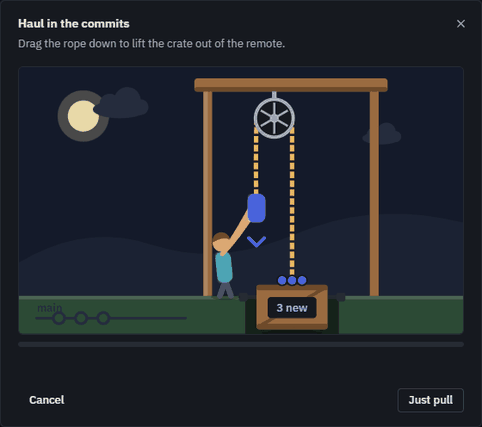
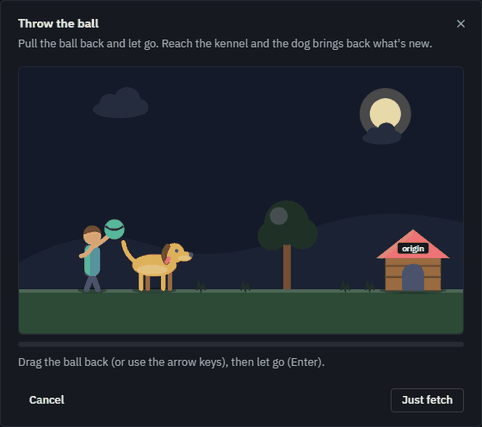
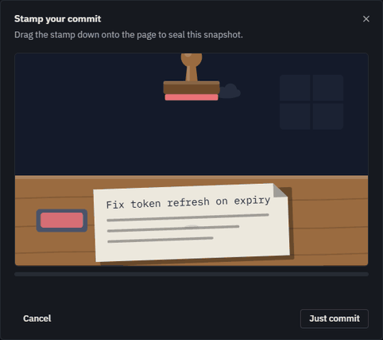
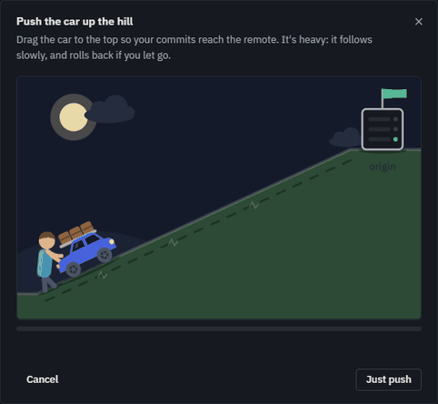
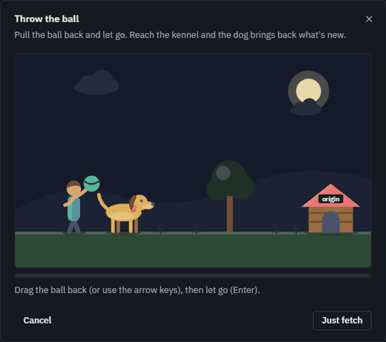

# Fun mode

Settings → General → Fun. Each Git action becomes a small task; the scene then shows the real result.

| | Success | Failure |
|---|---|---|
| **Pull** |  |  |
| **Push** |  |  |
| **Fetch** |  |  |
| **Commit** |  |  |

Letting go of the car early: 

A throw that falls short: 
